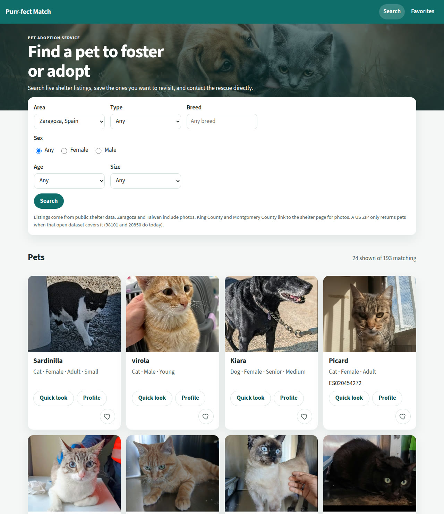

# Purr-fect Match

Search live shelter listings, save pets to compare, and contact the rescue.



**Live demo:** [halliecalhoun.github.io/Purr-fect-Match](https://halliecalhoun.github.io/Purr-fect-Match/)

The link works after this is merged to `master` and GitHub Pages is turned on (same idea as [where2p-app](https://halliecalhoun.github.io/where2p-app/)).

## Features

- Filter adoptable pets by area, type, breed, sex, age, and size
- Quick look, then a profile with the shelter phone, email, website, and a map
- Save and remove favorites in this browser
- Phone layout, keyboard access, and labeled controls

## Tech stack

- HTML, CSS, and JavaScript, with no build step and no API keys
- [Petnecto](https://petnecto.com) for public shelter listings
- [OpenStreetMap](https://www.openstreetmap.org/copyright) for the shelter map
- GitHub Pages

## Run locally

Node 18 or newer. Nothing to install.

```bash
npm start
```

Open [http://localhost:8000](http://localhost:8000).

```bash
npm test
```

## Deploy

Pages publishes the site from `master`.

1. Merge to `master`.
2. Open **Settings → Pages → Build and deployment**.
3. Set **Source** to **GitHub Actions**. [`.github/workflows/pages.yml`](.github/workflows/pages.yml) publishes each push to `master`.

**Deploy from a branch** also works, the same way as where2p-app: branch `master`, folder `/ (root)`. A `.nojekyll` file is already in the root. If you use branch publishing, delete the Actions workflow so that job does not fail.

## Where the pets come from

Listings are open shelter data. Zaragoza and Taiwan include photos. In the US, the datasets behind the app are King County, Washington and Montgomery County, Maryland, so other ZIP codes come back empty and the page points you at those areas. Adoption goes through the shelter.

## Authors

Hallie Calhoun, Alfred Chan, Christopher Celestino, and Victoire Baron.
